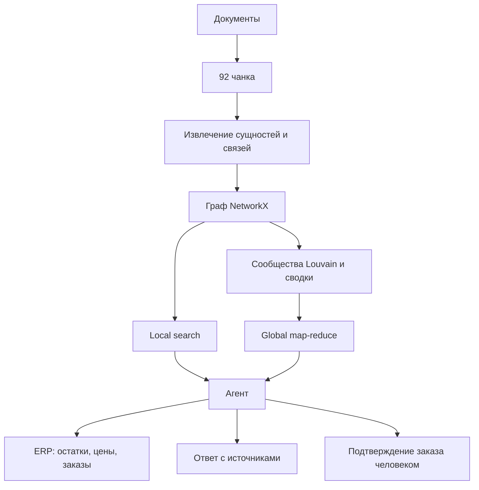

# GraphRAG-ассистент сервисной службы «ПолярТех»

**Финальный проект по искусственному интеллекту**

Поиск детали по модели и ошибке, проверка ERP и безопасная подготовка заказа.

| Параметр | Значение |
|---|---|
| Участник | Даниил Минаков |
| Модель | `qwen3:4b-instruct-2507-q4_K_M` |
| Эмбеддинги | `bge-m3` |
| Версия решения | commit `7fa876c` |
| Дата результатов | 3 ноября 2026 года |
| Репозиторий задания | <https://github.com/itmo-digital-culture/llm-project> |
| Публичный форк команды | **TODO: вставить URL открытого репозитория с меткой `v1.0`** |

<!--
Перед формированием финального PDF:
1. Вставить ссылку на публичный форк.
2. Обновить commit/tag.
3. Добавлять участников только после их реального вклада и собственных коммитов.
4. Перепроверить метрики после любых изменений кода.
-->

## Ключевой результат

После исправления извлечения и global search агент достиг общей accuracy `0.708`, tool accuracy `0.800` и fabricated rate `0.000`. Global search правильно ответил на 4 из 4 обзорных вопросов открытого набора.

## 1. Задача

Диспетчер сервисной службы получает от клиента модель холодильного оборудования и код ошибки. Ассистент должен по техническим документам определить отказавший узел и конкретную деталь, учесть цепочку замен снятых с производства деталей, затем запросить в ERP актуальные цену и остаток. Создание сервисного заказа меняет состояние учётной системы, поэтому выполняется только после явного подтверждения человека.

Плоский RAG хорошо отвечает на прямые вопросы, но теряет информацию, распределённую по нескольким документам. Например, на вопрос **«Какой узел чаще всего отказывает в линейке Гольфстрим?»** baseline отказался отвечать, тогда как global GraphRAG агрегировал факты из 13 сервисных отчётов и правильно назвал циркуляционный насос.

Бизнес-ценность решения:

- сокращение времени поиска нужной детали;
- снижение риска заказа устаревшей позиции;
- проверяемость ответа по документам;
- использование актуальных данных ERP;
- сохранение контроля человека над созданием заказа.

Корректный ответ должен соблюдать следующие условия:

- номера модели, детали и ошибки подтверждены документами или результатом инструмента;
- цепочка `REPLACED_BY` заканчивается актуальной деталью;
- цена и остаток берутся только из ERP;
- при неизвестном коде система честно отказывается отвечать;
- заказ не создаётся без подтверждения пользователя.

## 2. Решение

Архитектура соответствует шести обязательным модулям задания и разделяет генерацию текста моделью и детерминированные проверки в коде.

### 2.1. Извлечение и граф

Документы делятся на 92 чанка. Qwen возвращает сущности и отношения по заданной JSON Schema. Код нормализует номера моделей, деталей и ошибок, приводит названия к словарю и проверяет, что извлечённые коды действительно присутствуют в исходном тексте. Связь сохраняется только тогда, когда прошли проверку оба её конца. Невалидные записи учитываются в поле `dropped`.

Дополнительные проверки исправляют типичные ошибки небольшой локальной модели: ложные связи `FAILED` из руководств и неверное направление `REPLACED_BY`. Направление замены сохраняется от старой детали к новой.

Результаты всех чанков объединяются в ориентированный граф `NetworkX DiGraph`. Узлы имеют канонические идентификаторы и список источников. Рёбра содержат тип, вес и источники; вес равен числу разных чанков, в которых найдена связь. Двусторонние конфликты `REPLACED_BY` разрешаются по требованиям FR-2.

### 2.2. Сообщества и поиск

Алгоритм Louvain с фиксированным `seed` разбивает граф на сообщества. Каждый узел относится ровно к одному сообществу. Для каждого сообщества Qwen одним вызовом создаёт сводку длиной до 150 слов, а числовые показатели заранее считает код.

В local search сущности из вопроса становятся опорными узлами. Для нескольких опорных сущностей выбираются факты на путях длиной до трёх связей, а для одной — окрестность глубиной до двух связей. Также добавляются цепочки `REPLACED_BY`. Модель получает только отобранный и пронумерованный список фактов с источниками.

Global search предназначен для обзорных вопросов. На map-шаге модель обрабатывает сводки девяти сообществ и оценивает полезность частичных ответов. На reduce-шаге положительные результаты объединяются в итоговый ответ. Для вопросов о частоте дополнительно используются проверенные агрегаты по весам `FAILED`, поэтому повторение текста моделью не считается новым фактом.

### 2.3. Агент и ERP

Агент использует GraphRAG как инструменты `search_knowledge` и `summarize_topic` наравне с ERP-инструментами `check_stock`, `get_price` и `create_service_order`.

Детерминированный цикл:

- ограничивает число шагов;
- проверяет формат и происхождение номера детали;
- валидирует склад и количество;
- не выполняет одинаковый вызов повторно;
- повторяет только временно недоступные ERP-запросы;
- различает отсутствие данных и нулевой остаток;
- сверяет коды, цены и остатки в финальном ответе с вопросом и результатами инструментов;
- останавливается перед созданием заказа, пока человек его не подтвердил.

## 3. Результаты

Оценка выполнена на 24 вопросах: 5 local, 7 multihop, 4 global, 5 tool и 3 refusal. Все числа получены на локальной модели Qwen 4B с `temperature=0` и `seed=7`.

### 3.1. Accuracy по типам вопросов

| Режим | Все | Local | Multihop | Global | Tool | Refusal |
|---|---:|---:|---:|---:|---:|---:|
| Baseline | 0.500 | 1.000 | 0.571 | 0.000 | 0.000 | 1.000 |
| Local | 0.583 | 0.800 | 0.571 | 0.750 | 0.000 | 1.000 |
| Global | 0.292 | 0.000 | 0.000 | 1.000 | 0.000 | 1.000 |
| Agent | **0.708** | 0.800 | 0.429 | 0.750 | **0.800** | 1.000 |

Global search имеет низкую общую accuracy, потому что не предназначен для конкретных local-, multihop- и ERP-вопросов. При этом он решил все четыре вопроса своей категории. Агент показал лучшую общую accuracy и единственный смог выполнять вопросы, требующие ERP.

### 3.2. Источники, выдуманные факты и стоимость

| Режим | Source recall | Fabricated rate | LLM calls / question | Tokens / question |
|---|---:|---:|---:|---:|
| Baseline | 0.856 | 0.000 | 1.000 | 1 356 |
| Local | 0.906 | 0.042 | 0.875 | 776 |
| Global | 0.734 | 0.000 | 8.583 | 12 672 |
| Agent | **0.906** | **0.000** | 3.875 | 4 543 |

Global search дороже остальных режимов, потому что выполняет map-вызов для каждого из девяти сообществ. Agent тратит больше baseline и local, но объединяет поиск по документам и обращения к ERP.

### 3.3. Извлечение и индекс

| Показатель | Значение | Комментарий |
|---|---:|---|
| Entity precision / recall | 0.970 / 0.964 | 168 найдено, 165 в эталоне |
| Relation precision / recall | 1.000 / 0.913 | 151 найдено, 161 в эталоне |
| Отброшено на эталонных документах | 42 | Некорректные сущности и связи |
| Полный индекс | 107 узлов, 256 рёбер | 9 сообществ, 0 конфликтов |
| Стоимость индексации | 113 вызовов | 77 680 prompt + 64 972 completion tokens |

В полном графе содержится 96 связей `HAS_PART`: каждая из 12 моделей связана с восемью деталями. Все 40 сервисных отчётов представлены в источниках связей `FAILED`.

## 4. Где граф помогает и где уступает

### 4.1. Выигрыш GraphRAG: обзор отказов Гольфстрима

| Режим | Результат | Причина |
|---|---|---|
| Baseline | Отказ | Ни один близкий чанк не содержит общую частоту по линейке |
| Global | Циркуляционный насос | Суммированы веса `FAILED` по 13 отчётам |

Ответ зависит не от одного документа, а от агрегации фактов по моделям GS-410, GS-420, GS-510 и GS-520. Это основное измеренное преимущество GraphRAG в текущем решении.

### 4.2. Выигрыш агента: остаток P-1118B

На вопрос **«Сколько штук детали P-1118B есть на складе в Казани?»** baseline, local и global не могут ответить, потому что складские данные отсутствуют в документах. Agent вызвал `check_stock` с проверенными аргументами и вернул 12 штук. Этот пример показывает необходимость разделения базы знаний и ERP.

### 4.3. Где граф уступил: регламент для E-17

| Режим | Результат | Причина |
|---|---|---|
| Baseline | `SP-104` — верно | Прямой текст процедуры попал в ближайшие чанки |
| Local / Agent | Процедура не указана | В выбранных фактах отсутствует `E-17 -FIXED_BY-> SP-104` |

GraphRAG не гарантирует превосходство. Если извлечение пропустило связь или retrieval не включил её в контекст, плоский поиск может сохранить больше полезного исходного текста.

## 5. Ошибки системы

| Ошибка | Этап | Наблюдение | Проверяемое исправление |
|---|---|---|---|
| dev-01: не найден `SP-104` | Извлечение / поиск | GraphRAG видит E-17 и узел, но не процедуру | Повысить покрытие `FIXED_BY` и повторить local eval |
| dev-14: local не учитывает частоту | Поиск | Local видит уникальные рёбра, но не частоту отчётов | Частотные запросы направлять в global |
| dev-16: agent не находит снятые детали | Планирование | Агент выбрал `search_knowledge` вместо `summarize_topic` | Добавить routing по обзорным намерениям |
| dev-21: заказ не засчитан evaluator | Инструмент / orchestration | Заказ безопасно остановлен, но `pending_action` не дошёл до evaluator | Явно возвращать ожидающий tool call |

Доля ответов с выдуманными фактами: baseline `0.000`, local `0.042`, global `0.000`, agent `0.000`. На эталонных документах при извлечении отброшено 42 записи, а при полной индексации — 271. Строгая фильтрация уменьшает число ложных связей, но может удалить и полезные отношения.

## 6. Границы системы и контроль человека

Чтение документов, получение цены и проверка остатка являются обратимыми операциями и выполняются автоматически. Создание заказа меняет состояние ERP, поэтому передаётся человеку на подтверждение.

| Инвариант | Как обеспечен |
|---|---|
| Неизвестная деталь не отправляется в ERP | Part ID должен присутствовать в вопросе или результате предыдущего инструмента |
| Количество положительное и явно указано | `qty` валидируется до вызова `create_service_order` |
| Заказ без подтверждения не создаётся | При `confirm=False` формируется `pending_action` |
| Временный сбой ERP повторяется ограниченно | Не более трёх попыток; rejected и not found не повторяются |
| Цена и остаток не выдумываются | Финальный ответ сверяется с результатами ERP |
| Цикл агента конечен | `max_steps` ограничивает число вызовов инструментов |

На dev-21 safety-механизм сработал: агент определил актуальную `P-2054C`, проверил 6 штук на складе Москва и цену 6 750 рублей, после чего остановился перед созданием заказа. Фактический заказ без подтверждения создан не был.

## 7. Следующий проверяемый шаг

Добавить детерминированный intent router перед выбором поискового инструмента: частотные и обзорные вопросы направлять в global search, а вопросы о конкретных кодах и деталях — в local search.

Критерий успеха: dev-16 становится верным, global accuracy агента растёт с `0.750` до `1.000`, а tool accuracy и fabricated rate не ухудшаются. Отдельно необходимо проверить восстановление `FIXED_BY` для dev-01.

Этот раздел описывает идею дальнейшего измеримого улучшения, требуемую рубрикой, а не незавершённость обязательной реализации.

## 8. Вклад участников

| Участник | Вклад                                                                                                                            |
|---|----------------------------------------------------------------------------------------------------------------------------------|
| Даниил Минаков | Реализация Extraction, graph builder, communities, local/global search, agent tools, control loop, анализ и первая версия отчёта |

<!--
После реального подключения команды добавить строки, например:
| Имя участника | Конкретные просмотренные или изменённые модули, измеренные исправления, прогоны и разделы отчёта |

Не приписывать участнику уже выполненную работу. Вклад должен подтверждаться его собственными коммитами.
-->

На текущем зафиксированном этапе проект выполнен одним участником. История содержит шесть тематических коммитов: extraction/graph, communities/search, agent/tools и три измеренных исправления. Каждый коммит сопровождается отдельной локальной русскоязычной заметкой «что, где и зачем».

## 9. Использование ИИ-инструментов

- Codex использовался как ассистент разработчика: для анализа требований, подготовки черновиков реализации, поиска ошибок и ревью кода.
- Qwen3 4B через локальную Ollama использовался внутри проекта для extraction, summaries, search и agent planning.
- BGE-M3 использовался для эмбеддингов baseline retrieval.
- Результаты проверялись контрактными тестами, Ruff, полным pytest, evaluation JSON и ручным прогоном контрольных вопросов.

## Итог

Реализованы все шесть обязательных модулей. Полный pytest содержит 142 успешных теста, relation precision равен `1.000`, а агент решает `70.8%` открытого набора без зафиксированных выдуманных фактов. Измеренное преимущество GraphRAG получено на обзорных вопросах; агент дополнительно объединяет документальные факты с актуальными данными ERP. Основные ограничения связаны с полнотой извлечения и выбором режима поиска агентом.

